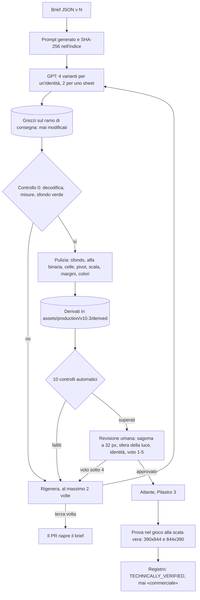

# CHRONOS Adventure: Nox & Lulù — Grafica

## Pilastro 2: pipeline di produzione

2 novembre 2026 · in revisione · `COMMERCIAL_RELEASE = BLOCKED`

Il Pilastro 1 è approvato (D28): regole di stile, e rigenerazione a 288 px di Cathedral Bone Tyrant, Toxic Forge Behemoth e Shadow Reaper. **Questo documento non modifica asset né codice del gioco.**

**Il team.** **AD**, Art Director; **TA**, Technical Artist; **PR**, Producer. **[FATTO]** = letto nel repo; **[IPOTESI]** = valore proposto, con la ragione.

---

## 0. La pipeline che esiste già **[FATTO]**

| Passo | Strumento | Cosa fa |
|---|---|---|
| Prompt | `tools/build_preproduction_prompts.py` | Un file `.md` per tavola, con 8 sezioni (identità, soggetto, stile, camera e luce, pose, famiglia, sfondo, restrizioni). `INDICE.json` con SHA-256. Stato: `PROMPT_READY` |
| Generazione | GPT esterno (Terra, Astra, Manus) | Consegna su un ramo `delivery/<pacchetto>`, cartella `deliveries/<pacchetto>/` |
| Sfondo | `tools/gpt_chroma.py` | «Verdezza» = G − max(R, B). Sfondo se ≥ 200, disegno se ≤ 120. Toglie l'alone verde solo nei 3 px del bordo |
| Controllo | `tools/verify_preproduction_delivery.py` | Decodifica, misure, peso, SHA-256, quota di verde, soggetto che non tocca il bordo, pixel quasi verdi, notte con la stessa geometria del giorno (correlazione ≥ 0,6), varianti alte come la v01 ±8 %. Stati `TECHNICALLY_VERIFIED` o `CONCEPT_ONLY`; mai «integrato» |
| Impaginazione | `tools/clean_sheet_layout.py`, `tools/fit_gpt_race_props.py`, `tools/verify_terra_*.py` | Celle con margine, adattamento con filtro Lanczos, contratti su maschere e hitbox |
| Originali | `deliveries/…` sui rami di consegna | Gli originali restano lì. I master vanno in `assets/preproduction/`, i file di gioco in `game/art/` |

**Cosa manca rispetto alle regole del Pilastro 1.**
- Nessun controllo su densità, numero di colori, contorno, colori riservati, alfa binaria e sagoma a 32 px.
- I prompt dei boss del pacchetto «310» usano regole diverse: sagoma «a 110 px», sheet 1536 × 1024 senza contratto di cella, e palette che entrano nei colori riservati.

| Boss | Colore nel prompt v01 | Tonalità, saturazione, luminosità | Problema |
|---|---|---|---|
| Shadow Reaper | #9AE8FF | 194°, 0,40, 1,0 | Nel **ciano di Nox** |
| Vega | #59E0FF | 191°, 0,65, 1,0 | Nel **ciano di Nox** |
| Cathedral Bone Tyrant | #7AE8D8 | 171°, 0,47, 0,91 | Al confine tra «interattivo» e Nox |
| Toxic Forge Behemoth | #FF8A4A | 21°, 0,71, 1,0 | Nel pericolo: ammesso solo sugli attacchi, ≤ 5 % |

Quindi i prompt dei 4 boss della Parte I vanno riscritti come **v2**. Le v01 restano com'erano: una versione pubblicata non si modifica.

---

## 1. Il brief: un file per asset, con versione

**Dove:** `requests/<pacchetto>/brief/<asset_id>.v<N>.json`. Il prompt `.md` lo genera uno strumento a partire dal brief, sempre uguale a parità di brief, e il suo SHA-256 va nell'`INDICE.json`. **Una versione pubblicata non si modifica mai:** per cambiare qualcosa si scrive la v<N+1>.

| Campo | Esempio per Shadow Reaper v2 | Regola del Pilastro 1 |
|---|---|---|
| `asset_id`, `versione` | `boss.shadow_reaper.sheet`, `2` | — |
| `soggetto` | Identità e momento narrativo, presi dal canone | — |
| `vista` | Dall'alto 3/4, come la camera del gioco | — |
| `luce` | Una sola, dall'alto a sinistra; ombre a gradini in basso a destra; nessuna ombra a terra | L1–L3 |
| `palette_id` e colori | Palette del distretto (Glass Flood), più 64 colori propri al massimo | P1, P2 |
| `colori_vietati` | Bande di Nox (175–200°), di Lulù (275–325°) e interattivo (140–170°), con saturazione ≥ 0,35 e luminosità ≥ 0,9. Pericolo solo sugli attacchi | P4 |
| `contorno` | 2 px, il tono più scuro della rampa del materiale; nero puro ≤ 10 % | C1–C3 |
| `sfondo` | #00FF00 piatto, almeno 40 px di verde su ogni lato, nessun colore del soggetto vicino al verde | Come oggi |
| `tela` e `cella` | Cella 320 × 320, 8 colonne | S1, S2 |
| `altezza_soggetto` | 288 px, con i piedi alla stessa riga in ogni cella | S2 |
| `stati` | Vedi il contratto dei boss (§6) | — |
| `varianti` | 4 per l'identità, 2 per lo sheet | §2 |
| `riferimenti` | Strisce di oggi da 128 px (solo per l'identità), sagoma di Nox per la scala | — |
| `restrizioni` | Quelle di oggi (nessun testo, nessun marchio, nessun valore di gioco), più il canone su Nox e Lulù | T1 |

---

## 2. Generazione: quante varianti, come si sceglie, quando si rigenera

| Situazione | Varianti | Perché |
|---|---|---|
| **Identità nuova** (un boss, un nemico nuovo) | **4** | L'identità si sceglie una volta sola e decide tutto il resto |
| **Sheet di un'identità già approvata** | **2** | Serve coerenza, non invenzione |
| **Correzione di una consegna** | **1** | Si corregge un difetto preciso |

**Come si sceglie, in quest'ordine.**
1. Passa tutti i controlli che bloccano (§4) dopo la pulizia.
2. Errore al 95° percentile ≤ 35 su 441 dopo la riduzione dei colori **[IPOTESI]**: è il valore che Nox raggiunge con 32 colori.
3. Sagoma a 32 px: sovrapposizione ≤ 0,65 con Nox e con Lulù.
4. Voto dell'AD da 1 a 5 su identità e leggibilità: **almeno 4**.

**Si rigenera quando:**
- un controllo che blocca fallisce anche dopo la pulizia;
- in uno sheet, l'altezza del soggetto varia più di ±8 % tra le celle (la regola di famiglia di oggi);
- l'identità cambia tra le celle: costume, accessori, proporzioni;
- lo sfondo non si toglie: più dello 0,5 % del bordo ha una verdezza sotto 200.

**Il limite.** Al massimo **2 rigenerazioni** per asset. Alla terza, il PR riapre il brief invece di generare di nuovo.

---

## 3. Pulizia: dal grezzo al derivato

Ogni passo scrive in una cartella nuova. **L'originale grezzo non si modifica mai.**

| # | Passo | Valori | Strumento |
|---|---|---|---|
| 1 | Togliere lo sfondo | Verdezza ≥ 200 = sfondo, ≤ 120 = disegno, alone tolto nei 3 px del bordo | `gpt_chroma.py` (esiste) |
| 2 | Alfa binaria | Alfa ≥ 128 diventa 255, sotto diventa 0 | Nuovo |
| 3 | Tagliare le celle | Riquadro dei pixel opachi, per ogni posa isolata | Nuovo, sul modello di `clean_sheet_layout.py` |
| 4 | Pivot ai piedi | Mediana dei pixel opachi dei piedi nel 12 % più basso; stessa riga di base in ogni cella | Lo stesso metodo del manifest chrono (`anchor_method`) |
| 5 | Scala | Filtro Lanczos fino all'altezza S2, ±2 % | Come `fit_gpt_race_props.py` |
| 6 | Margini uniformi | Almeno 12 px vuoti su ogni lato della cella. Gli sheet H-17 e ARC-7 (D11) usano già 12 px sopra, a sinistra e a destra | Nuovo |
| 7 | Riduzione dei colori | Alla palette del distretto più i colori propri, entro i limiti di P1 | Nuovo |
| 8 | Contorno | Solo controllo. Se fallisce si rigenera. Il contorno aggiunto dallo script è ammesso **solo** sugli oggetti alti al massimo 48 px | Nuovo |
| 9 | Rapporto | JSON con le misure di ogni controllo, accanto al derivato | Nuovo |

**Cartelle**

| Cosa | Dove | Si può modificare? |
|---|---|---|
| Brief e prompt | `requests/<pacchetto>/brief/`, `…/prompt/` | No: si aggiunge una nuova versione |
| Grezzi | Ramo `delivery/<pacchetto>`, cartella `deliveries/<pacchetto>/` | **Mai.** Il loro SHA-256 sta nel registro |
| Derivati | `assets/production/v10.3/derived/<asset_id>/v<N>/` | Si rigenerano dallo script, non a mano |
| File di gioco | `game/art/…` | Solo dall'impaginazione degli atlanti (Pilastro 3) |

---

## 4. Dieci controlli automatici (test Node)

I test leggono i PNG con `pngjs`, che è già tra le dipendenze del repo (`package.json`) **[FATTO]**. Girano con `npm test` su ogni derivato elencato nel registro. Se un derivato non esiste ancora, il test lo segnala come mancante, senza dare né PASS né FAIL.

| # | Controllo | Soglia | Blocca? | Regola |
|---|---|---|---|---|
| 1 | **Decodifica e misure** | PNG valido; larghezza e altezza uguali alla tela del brief | Sì | — |
| 2 | **Griglia e margini** | Misure multiple della cella; nessun pixel opaco nei 12 px di margine | Sì | — |
| 3 | **Alfa binaria** | Solo 0 o 255 | Sì | Alfa |
| 4 | **Niente alone verde** | Nessun pixel opaco con verdezza ≥ 120 | Sì | — |
| 5 | **Altezza e famiglia** | Soggetto alto come S2 ±2 %; tra le celle ±8 % | Sì | S1, S2 |
| 6 | **Pivot** | Piedi alla stessa riga ±1 px e allo stesso centro ±2 px in ogni cella | Sì | — |
| 7 | **Colori** | Entro i limiti di P1; 100 % nella palette per gli ambienti, ≥ 75 % per i nemici | Sì | P1, P2 |
| 8 | **Colori riservati** | ≤ 1 % fuori dal proprietario; pericolo ≤ 5 % sui nemici | Sì | P4 |
| 9 | **Contorno** | Fascia di 2 px sul bordo ≤ 0,5 × interno; nero puro ≤ 10 % | Sì | C2, C3 |
| 10 | **Peso e originale intatto** | Peso entro il budget del Pilastro 3; SHA-256 del grezzo uguale a quello del registro | Sì | — |

**Avvisi che non bloccano** e vanno a un tester: luce (L1), fascia bassa (L3), sovrapposizione con le altre sagome (Sil2), posa d'attacco (Sil4).

**Esempio: controlli 3 e 7 con pngjs**

```js
// tests/art-derived.test.mjs — proposta, non ancora nel repo.
import test from 'node:test';
import assert from 'node:assert/strict';
import {readFileSync, existsSync} from 'node:fs';
import {PNG} from 'pngjs';

const registry = JSON.parse(readFileSync('assets/production/v10.3/derived/REGISTRO.json', 'utf8'));

for (const asset of registry.assets) {
  test(`${asset.id}: alfa binaria e colori (controlli 3 e 7)`, t => {
    if (!existsSync(asset.derived)) return t.skip('derivato mancante: nessun PASS, nessun FAIL');
    const png = PNG.sync.read(readFileSync(asset.derived));
    const colours = new Set();
    for (let i = 0; i < png.data.length; i += 4) {
      const a = png.data[i + 3];
      assert.ok(a === 0 || a === 255, `alfa ${a} al pixel ${i / 4}`);
      if (a === 255) colours.add((png.data[i] << 16) | (png.data[i + 1] << 8) | png.data[i + 2]);
    }
    assert.ok(colours.size <= asset.maxColours, `${colours.size} colori, limite ${asset.maxColours}`);
  });
}
```

---

## 5. Il flusso



---

## 6. Contratto dei boss rigenerati (applica D28) **[IPOTESI]**

| Voce | Valore |
|---|---|
| Altezza disegnata | 230 u, come Archon |
| Altezza sorgente | 230 × 1,25 = 287,5, cioè **288 px** |
| Cella | **320 × 320**: 288 px più 2 × 16 px di margine |
| Colonne | 8 |
| Stati e fotogrammi | Fermo 4 · cammina 4 · preparazione 4 · attacco 4 · recupero 2 · colpito 2 · cambio di fase 4 · sconfitto 4 = **28 fotogrammi** su 4 righe, cioè 2560 × 1280 |
| Da dove vengono gli stati | Dagli stati del boss chrono di oggi (`chrono-manifest.mjs`: idle, anticipation, attack, phase_transition, stagger, defeat) **[FATTO]**. La lista definitiva dipende dalle mosse di ciascun boss, ancora da progettare |
| Misura dell'atlante | La decide il Pilastro 3: potenza di due e budget di memoria |

---

## 7. Costi (il PR)

| Voce | Conto | Totale |
|---|---|---|
| 3 boss approvati (D28) | 3 × (4 varianti d'identità + 2 di sheet) | **18 immagini** |
| Vega, nono boss (D23) | 4 + 2 | **6 immagini** |
| Correzioni previste | Circa 1 per boss **[IPOTESI]** | **circa 4** |
| **Totale** | | **circa 28 immagini** |
| Tempo del team | Pulizia e controlli automatici; revisione umana di circa 15 minuti per sheet **[IPOTESI]** | circa 1 ora per i 4 boss |

---

## Conflitti dichiarati

| Conflitto | Scelta | Chi prevale |
|---|---|---|
| L'AD vuole 6 varianti per ogni identità, il PR ne vuole 2 | **4** per un'identità nuova, **2** per uno sheet | Il PR, con il limite dell'AD sulla qualità: voto ≥ 4 |
| Il TA vuole aggiungere il contorno con uno script, l'AD teme i difetti sui personaggi | Contorno a script **solo** sugli oggetti ≤ 48 px; boss e nemici si rigenerano | L'AD: sui personaggi un contorno a macchina si nota subito |
| Riscrivere i prompt v01 dei boss, o correggerli | **Nuove v2**; le v01 restano com'erano | Il PR: tracciabilità |

## Cosa serve per partire

Con il tuo sì, il passo successivo è uno strumento che scrive i **brief v2** dei 4 boss (Bone Tyrant, Behemoth, Shadow Reaper, Vega) e i relativi prompt, più i 10 test. Le immagini le genera poi GPT o Manus, come oggi.
