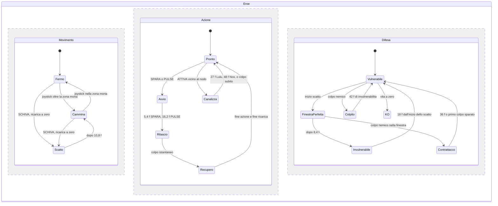
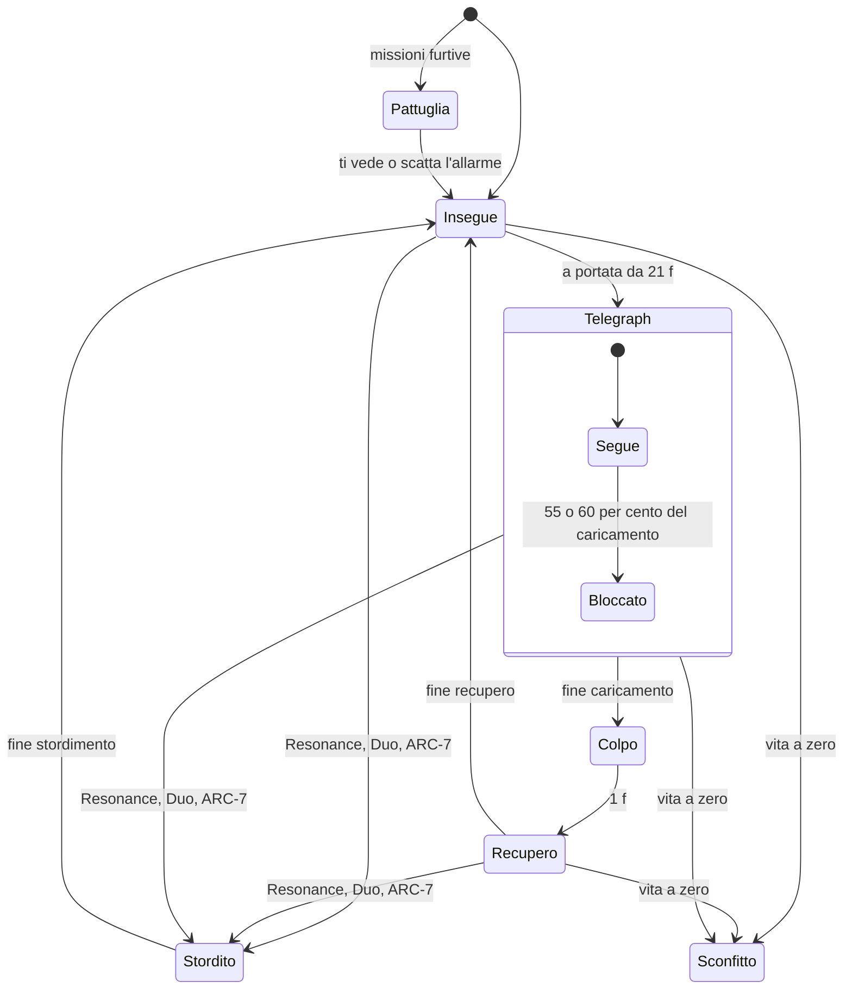

# CHRONOS Adventure: Nox & Lulù — Combattimento e audio

## Pilastro 2: stati e frame data

2 novembre 2026 · **approvato dall'autore** (D29; confermato come proposto in D31, Chrono Shift compreso; G1, E1 e CS non ancora implementati) · `COMMERCIAL_RELEASE = BLOCKED`

Repo letto: `Flexati/Adventure-city`, ramo `work/chronos-adventure-commercial`. **Questo documento non modifica il codice del gioco.** Il Pilastro 1 è approvato (D27).

**Il team.** **GSD**, Game Systems Designer Senior; **AD**, Audio Director.

**Legenda**
- **[FATTO]**: letto nel codice (`file:riga`).
- **[IPOTESI]**: valore proposto, con la ragione.
- **OGGI, NUOVO, NO**: come nel Pilastro 1.

**I frame.** Frame = secondi ÷ 0,01667 (1 frame = 16,67 ms a 60 Hz). Il gioco oggi non va a passo fisso (Pilastro 1, punto 0.2): i frame qui sotto sono **i secondi del codice convertiti**. Il passo fisso si progetta nel Pilastro 4.

---

## 0. Come funziona oggi, in quattro fatti

1. **Muoversi non si blocca mai.** L'eroe cammina mentre spara e mentre usa il Pulse. Lo scatto parte anche durante un'azione (`campaign.mjs:293–302`) **[FATTO]**. CHRONOS non è un gioco in cui ci si «impegna» in un attacco.
2. **Essere colpiti non toglie il controllo.** Si perde 1 punto vita e si hanno 0,7 s di invulnerabilità. L'animazione di dolore dura 0,28 s ma non blocca i comandi (`campaign.mjs:203`) **[FATTO]**. Niente stordimento dell'eroe, niente spinta all'indietro.
3. **I danni non interrompono i nemici.** Un colpo non ferma il loro attacco. Lo fermano solo gli stordimenti: Resonance, Duo, ARC-7 (`campaign.mjs:156`, `168`, `183`, `303`) **[FATTO]**.
4. **La Perfect Dodge rallenta tutto il gioco**, Nox compreso: per 0,16 s reali la simulazione va al 40 % (`runtime.mjs:737`, `963`) **[FATTO]**. Il rallentamento nasce nella presentazione ma cambia la simulazione.

---

## 1. Il modello: tre livelli in parallelo

Poiché movimento, azione e difesa non si bloccano a vicenda, l'eroe non ha **uno** stato ma **tre stati contemporanei**. È il modo più fedele di descrivere il codice di oggi.

---

## 2. Frame data di Nox e Lulù **[FATTO]**

Valori comuni ai due eroi, salvo dove indicato.

| Stato | Durata | Frame | Si entra con | Si esce verso | Lo interrompe | Invulnerabile | Hitbox / hurtbox | Fonte |
|---|---|---|---|---|---|---|---|---|
| **Fermo / Cammina** | — | — | Joystick | Ogni stato | — | No | Hurtbox: proiettili entro 24 u; colpo in mischia se sei dentro il cerchio bloccato; carica entro 58 u | `campaign.mjs:312`, `338`, `342` |
| **Velocità** | 205 u/s (147,6 dopo l'Overdrive) | — | — | — | — | — | — | `campaign.mjs:294` |
| **Avvio SPARA** | 0,09 s | 5,4 | Tocco su SPARA, ricarica a zero, nessuna azione in corso | Rilascio | Niente (lo scatto non lo annulla) | No | — | `campaign.mjs:302` |
| **Rilascio SPARA** | istantaneo | 1 | Fine avvio | Recupero | — | No | Raggio largo 50 u (74 sui boss), lungo quanto la gittata dell'arma | `campaign.mjs:162`, `178` |
| **Recupero SPARA (C-9)** | 0,26 − 0,09 = 0,17 s | 10,2 | Rilascio | Pronto | — | No | — | `campaign.mjs:119` |
| **Avvio PULSE** | 0,27 s | 16,2 | Tocco su PULSE | Rilascio | — | No | — | `campaign.mjs:302` |
| **Recupero PULSE** | 0,65 − 0,27 = 0,38 s | 22,8 | Rilascio | Pronto | — | No | — | `campaign.mjs:118` |
| **Ricarica PULSE** | 3,5 s (potenziamento potenza) o 4,5 s | 210 o 270 | — | — | — | — | — | `campaign.mjs:120` |
| **Scatto** | 0,18 s a 660 u/s = 118,8 u | 10,8 | SCHIVA, ricarica a zero | Cammina | — | Sì, 0,30 s = 18 f dall'inizio | Hurtbox invariata ma invulnerabile | `campaign.mjs:293` |
| **Ricarica dello scatto** | 1,1 s (0,6 in Overdrive) | 66 (36) | Inizio scatto | — | — | — | — | `campaign.mjs:293` |
| **Finestra Perfect Dodge** | 0,14 s (0,20 in Overdrive) | 8,4 (12) | Inizio scatto | Contrattacco se un colpo arriva | — | Sì | — | `campaign.mjs:293`, `206` |
| **Contrattacco pronto** | 0,6 s | 36 | Perfect Dodge | Primo colpo: + danno, rompe la guardia | Scade | — | — | `campaign.mjs:204`, `167` |
| **Colpito** | Invulnerabilità 0,7 s; animazione 0,28 s | 42; 16,8 | Colpo nemico fuori dalla finestra e fuori dall'invulnerabilità | Vulnerabile | — | Sì, 42 f | — | `campaign.mjs:203` |
| **Canalizza (ATTIVA)** | 0,45 s Lulù, 0,8 s Nox | 27; 48 | ATTIVA entro 85 u da un nodo libero | Nodo acceso | Colpo subito, o allontanarsi oltre 95 u | No | — | `campaign.mjs:199`, `295` |
| **Duo** | Animazione 0,65 s | 39 | DUO a barra 100 | — | — | Sì, 1,0 s = 60 f | Cerchio di 300 u: danno ×2, stordimento 1,2 s = 72 f, +2 vita | `campaign.mjs:303` |
| **KO** | — | — | Vita a zero | Riprova o checkpoint del boss | — | — | — | `campaign.mjs:350` |

**Differenze tra i due eroi [FATTO]**

| | Nox | Lulù |
|---|---|---|
| **PULSE** | Colpo singolo, gittata 420 u, danno × 3 + 2. Nelle missioni al buio illumina per 2,6 s | **Resonance**: area di 240 u davanti, a ±72,5° (perché acos 0,3 = 72,5°), danno + 1, stordimento 2,2 s = 132 f (5 s nelle missioni furtive) (`campaign.mjs:160–168`; stordimento a `168`) |
| **Mossa da solo** (quando l'altra non c'è) | **Overdrive**: 5 s = 300 f, ricarica dell'arma × 0,5, scatto ogni 0,6 s; poi **surriscaldamento** di 2,2 s a velocità × 0,72 (`campaign.mjs:304`) | **Barriera**: muro di raggio 46 u per 9 s, ricarica 7 s = 420 f, al massimo 2 (`campaign.mjs:306`) |
| **Canalizza** | 48 f | 27 f |

**Armi (V9) [FATTO]** (`weapons-v9.mjs:3–7`, `campaign.mjs:119`, `302`)

| Arma | Colpi al frame | Durata dell'azione | Ricarica tra colpi | Caricatore / ricarica | Effetto |
|---|---|---|---|---|---|
| C-9 | 5,4 | 0,26 s = 15,6 f | 0,4 s = 24 f | 12 / 1,1 s = 66 f | — |
| VX-9 | 5,4 · 9,3 · 13,2 (raffica di 3) | 0,30 s = 18 f | 0,48 s = 28,8 f | 24 / 1,4 s = 84 f | — |
| R-12 | 5,4 (5 pallini, ventaglio 0,16 rad) | 15,6 f | 0,8 s = 48 f | 6 / 1,6 s = 96 f | — |
| H-17 | 5,4 | 15,6 f | 0,9 s = 54 f | 4 / 1,8 s = 108 f | Perfora 2 bersagli |
| ARC-7 | 5,4 | 15,6 f | 0,65 s = 39 f | 8 / 1,5 s = 90 f | Salta a 2 bersagli entro 125 u, stordisce 0,65 s = 39 f (non i boss) |

**Quickdraw:** dopo uno scatto, con la C-9, per 1 s il colpo successivo ricarica in 0,26 s invece di 0,4 (`campaign.mjs:116`) **[FATTO]**.

---

## 3. Due nemici tipo **[FATTO]**

Valori di `ROLE_SPECS` (`campaign.mjs:18–27`). Le missioni possono allungare il caricamento con `windupBonus` (`campaign.mjs:56`).

| Stato | Razziatore (mischia) | Tiratore (a distanza) |
|---|---|---|
| **Insegue** | Velocità 1,25 × quella del distretto; ti vede entro 320 u | 0,95 ×; ti vede entro 420 u; si tiene a 240 u |
| **Condizione d'attacco** | Sei entro 70 u, visibile, e insegue da almeno 0,35 s = 21 f | Entro 330 u, visibile, da almeno 21 f |
| **Telegraph, segue** | 0,95 × 55 % = 0,52 s = **31,4 f** (il cerchio ti segue) | 0,7 × 60 % = 0,42 s = **25,2 f** (la linea ti segue) |
| **Telegraph, bloccato** | 0,95 − 0,52 = 0,43 s = **25,7 f** | 0,7 − 0,42 = 0,28 s = **16,8 f** |
| **Colpo** | Al frame 57: colpisce chi è nel cerchio di 68 u | Al frame 42: proiettile a 430 u/s, vita 1,6 s = 96 f |
| **Recupero** («esposto») | 0,85 s = 51 f | 0,95 s = 57 f |
| **Colpito** | Animazione 0,24 s = 14,4 f, **nessuna interruzione** | Uguale |
| **Stordito** | Resonance 132 f · Duo 72 f · ARC-7 39 f. **Interrompe** anche il telegraph | Uguale |
| **Sconfitto** | Animazione 0,7 s = 42 f | Uguale |

**Quando premere per la Perfect Dodge.**
- **Contro il razziatore:** il colpo arriva al frame 57 del caricamento. Lo scatto deve iniziare tra il frame 57 − 8,4 = **48,6 e il 57**. Dopo il blocco (frame 31,4) restano 25,7 f per prendere il tempo.
- **Contro il tiratore:** il proiettile percorre 240 u in 240 ÷ 430 = 0,558 s = **33,5 f**. Lo scatto deve iniziare negli ultimi 8,4 f prima che entri nei 24 u attorno all'eroe.
- **Con la correzione C1 approvata,** questi frame si contano dal tocco, non dal rilascio del dito.

---

## 4. Sensazione dei colpi

| Elemento | Oggi **[FATTO]** | Decisione |
|---|---|---|
| **Hit-stop** | Nessuno sui colpi normali. Rallentamento globale al 40 % per 0,16 s sulla Perfect Dodge e per 0,4 s sul boss sconfitto (`runtime.mjs:718`, `737`) | **NUOVO G1: hit-stop solo visivo.** Si ferma l'animazione del bersaglio colpito, con un lampo bianco di 1 f: **2 f (33 ms)** per un colpo d'arma, **4 f (67 ms)** per il Pulse, **6 f (100 ms)** per il colpo che sconfigge. La simulazione non si ferma: tempi e hitbox restano identici **[IPOTESI]** sui valori (un blog cita 30–50 ms per Hades) |
| **Tremolio dello schermo** | Ampiezza in px, cala di 28 px al secondo: sparo 1,2 · Pulse 5 · colpo subito 5 · Duo 7 · boss sconfitto 10. Spento con «movimento ridotto» (`runtime.mjs:714–751`, `973`) | **OGGI**, invariato |
| **Spinta all'indietro** | Nessuna | **NO.** Sposterebbe nemici ed eroe, quindi le hitbox: è vietato |
| **Coyote time sulla schivata** | Nessuno | **NO.** Accettare una schivata premuta *dopo* il colpo cambierebbe il danno ricevuto. Il buffer N1 copre già il tocco dato un attimo *prima* |

---

## 5. Chrono Shift

**Oggi [FATTO].** Dopo una Perfect Dodge tutto il gioco va al 40 % per 0,16 s reali: nemici, proiettili **e Nox** (`runtime.mjs:737`, `963`). Il contrattacco resta pronto per 0,6 s.

**Proposta CS (NUOVO, serve il tuo sì)** **[IPOTESI]** sui valori:

| Parametro | Valore | Perché |
|---|---|---|
| Chi lo attiva | La Perfect Dodge di **Nox** | È la sua mossa nel brief. Lulù tiene la Perfect Dodge di oggi |
| Durata | **0,6 s di gioco = 36 f** | Coincide con la finestra del contrattacco: il colpo di risposta cade dentro il rallentamento |
| Cosa rallenta | Nemici e proiettili nemici a **× 0,5** | Il giocatore vede il mondo rallentare e capisce di avere un vantaggio |
| Cosa no | Nox, i suoi colpi, l'interfaccia, il joystick | Il controllo resta pieno: si risponde, non si aspetta |
| Ricarica | Al massimo uno ogni **3,0 s = 180 f** | Senza limite, con lo scatto ogni 1,1 s il mondo potrebbe restare lento fino al 55 % del tempo (0,6 ÷ 1,1). Con 3 s il massimo è il 20 % (0,6 ÷ 3,0) |
| Dove vive | Nella **simulazione**, come fattore di tempo per i nemici | Oggi il rallentamento nasce nella presentazione. Il Pilastro 4 lo sposta nella simulazione, così resta riproducibile |
| Senza audio | Bordo dello schermo ciano per 36 f, nemici desaturati | Il segnale visivo serve anche senza suono (Pilastro 3) |

**Il conflitto.** CS cambia i tempi dei nemici per 0,6 s, e la regola D21 vieta miglioramenti non richiesti. Il Chrono Shift però è nel tuo brief. **Serve una tua decisione esplicita.**

---

## 6. Il Duo

- **Il brief** dice che la Resonance di Lulù apre la finestra di contrattacco di Nox.
- **Il codice** ha un Duo a barra piena, con stordimento ad area (§2).
- **Decisione del GSD: NO al cambio.** Il Duo di oggi funziona ed è già bilanciato. Un Duo diverso cambierebbe il danno e il ritmo di tutte le missioni.
- La sinergia del brief esiste già in parte: la Resonance stordisce 2,2 s, e in quel tempo i colpi di Nox e del compagno arrivano senza risposta.

---

## 7. Il punto di vista dell'Audio Director

Il Pilastro 3 lega i suoni agli eventi che la simulazione emette già **[FATTO]** (`campaign.mjs`, `campaignEvent`):

`dash`, `perfectDodge`, `counter`, `shot`, `magic`, `impact`, `down`, `hurt`, `duo`, `overdrive`, `heat`, `barrier`, `enemyAttack`, `enemyShot`, `chargeEnd`, `bossWake`, `bossPhase`, `guarded`, `guardBroken`, `channel`, `channelBroken`, `node`.

**Manca un evento: l'istante in cui il telegraph si blocca.**
- È il momento in cui il giocatore deve prepararsi a schivare.
- Oggi solo il tratteggio di alcuni attacchi lo mostra.
- **NUOVO E1:** un evento `telegraphLock{x, y, kind}`, solo informativo. Non cambia la logica, ma permette un suono e un segnale visivo uguali per tutti i nemici.

**Conflitto dichiarato.**
- L'AD voleva uno hit-stop più lungo (8–10 f) per far sentire il peso degli impatti pesanti.
- Il GSD ha fissato il massimo a 6 f: oltre, su 6" il fermo si legge come un rallentamento del telefono.
- **Prevale il GSD.** Il peso in più lo dà il suono (Pilastro 3), non il fermo.

---

## Riepilogo

| Codice | Cosa | Tocca tempi o hitbox? |
|---|---|---|
| **G1** | Hit-stop solo visivo: 2, 4, 6 f | No: si ferma solo l'animazione |
| **E1** | Evento `telegraphLock` | No: solo informativo |
| **CS** | Chrono Shift di Nox: nemici × 0,5 per 36 f, al massimo ogni 180 f | **Sì**: serve una tua decisione esplicita |
| — | Spinta, coyote time, Duo nuovo | **NO**, scartati |

Nulla è applicato. Le proposte approvate entrano nel mandato per il terminale (Fase 4), insieme a C1, N1 e N2.
